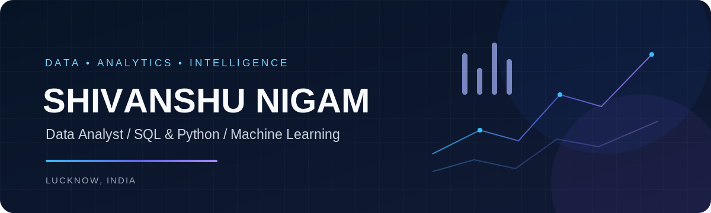

  

  
  
  

**Turning complex data into business intelligence and practical machine-learning solutions.**

Lucknow, India · Data Analytics · Business Intelligence · Applied Machine Learning

---

## Profile

I am a data analytics professional with **2+ years of experience** across telecom analytics, business reporting, and multi-location restaurant operations. I work with SQL, Python, BI tools, and operational datasets to investigate performance, validate information, and translate analysis into decisions.

My professional work has included recharge behaviour, customer demographics, data usage, site- and zone-level revenue, operational KPIs, and multi-platform transaction reconciliation. Alongside my analytics work, I build independent projects in statistical analysis and machine learning, with a growing focus on the engineering practices behind useful AI applications.

**What I bring:** quantitative reasoning (B.Sc. Mathematics), business context, structured problem-solving, and a bias toward measurable and explainable outcomes.

> **Career direction:** Data Analytics → Applied Machine Learning → MLOps and LLM-powered applications. The AI engineering topics below are learning and project interests, not claims of professional production experience.

## Professional Experience

### Vodafone Idea — MIS Executive (Analytics-focused)
**Payroll: Quess Corp Pvt. Ltd.** · Lucknow, India · **April 2026 – Present**

- Perform end-to-end recharge tracker analysis to examine First Recharge (FR) and base recharge behaviour, including recharge-value distributions and patterns.
- Analyse customer demographics and data-usage patterns for the Uttar Pradesh Telecom Circle.
- Investigate site-wise and zone-wise revenue and performance to support business monitoring.
- Extract and analyse operational data using **Apache Impala SQL** and **MS Access**.
- Prepare reporting for Marketing, Finance, and senior stakeholders, translating operational data into actionable findings.

**Tools:** Apache Impala SQL · MS Access · Excel · Business Reporting

### A.K. Infra & Realty Developers — Data Analyst
**July 2024 – April 2026** · Restaurant SaaS Operations

- Managed business reporting and KPI tracking for **four multi-location restaurants**.
- Consolidated operational, transactional, and commission datasets into centralised MIS reporting.
- Built **Looker Studio dashboards** to monitor business performance and operational KPIs.
- Performed data validation and reconciliation across **Talabat, Careem, Zomato, and Noon** datasets.
- Supported performance monitoring and operational decision-making through consistent reporting.

**Tools:** SQL · Excel · Looker Studio · Data Reconciliation · Multi-source Data Integration

---

## Technical Toolkit

The groups below distinguish hands-on tools from topics being actively developed. A technology appearing in a learning group should not be read as production experience.

### Analytics, SQL & BI

  
  
  
  
  
  
  
  
  
  
  

### Python & Data Science

  
  
  
  
  
  
  
  

### Data Workflows & Automation
- ETL and multi-source data integration
- Data cleaning, validation, and reconciliation
- SQL views and stored procedures
- Power Query transformations
- Reporting standardisation and automation

### Machine Learning & Applied AI

**Project / applied foundations:** supervised learning, unsupervised learning, feature engineering, model evaluation, classification, clustering, and threshold analysis.

**Currently learning:** MLOps, LLM fundamentals, retrieval-augmented generation (RAG), AI agents, and deployment patterns for AI applications.

### Development & Productivity

  
  

---

## Selected Projects

Projects are presented with their actual repository links where publicly verified. Some portfolio projects described below do not yet have a confirmed public repository URL; those are deliberately marked rather than linked to a guessed destination.

<table>
  <tr>
    <td width="50%" valign="top">
      <h3>Trust & Safety Risk Operations Analytics</h3>
      
<strong>Domain:</strong> Trust & Safety · Email Risk Classification

      
Built a baseline classifier to prioritise potentially unwanted email for risk review using the Apache SpamAssassin Public Mail Corpus.

      <ul>
        <li>Audited 6,047 emails and engineered 18 numerical features.</li>
        <li>Trained Logistic Regression with a source-aware train/test split.</li>
        <li>Evaluated precision, recall, false positives, and ROC-AUC to expose operational trade-offs.</li>
      </ul>
      
<strong>Reported evaluation:</strong> 90.16% accuracy · 93.35% spam precision · 67.4% spam recall · 0.9401 ROC-AUC.

      
<em>Repository URL to add after publication/verification.</em>

      
<code>Python</code> <code>Pandas</code> <code>scikit-learn</code> <code>Model Evaluation</code>

    </td>
    <td width="50%" valign="top">
      <h3>Cyberbullying Detection & Enforcement Trade-off Analysis</h3>
      
<strong>Domain:</strong> Trust & Safety · Content Moderation

      
Analysed multi-platform moderation data with an emphasis on error analysis, enforcement thresholds, and human-in-the-loop review.

      <ul>
        <li>Repository documents approximately 450K labelled content records.</li>
        <li>Used TF-IDF features and Logistic Regression.</li>
        <li>Examined false-positive and false-negative risks and threshold trade-offs.</li>
      </ul>
      
<a href="https://github.com/nigamshivanshu/Cyberbullying-Detection-Enforcement-Trade-off-Analysis">View repository →</a>

      
<code>Python</code> <code>TF-IDF</code> <code>Logistic Regression</code> <code>Trust & Safety</code>

    </td>
  </tr>
  <tr>
    <td width="50%" valign="top">
      <h3>Credit Card Acquisition & Growth Analytics</h3>
      
<strong>Domain:</strong> Financial Services · Growth Analytics

      
Analysed a credit-card acquisition and transaction dataset to understand the customer funnel and commercial performance.

      <ul>
        <li>Scope: 150K customers, 150K applications, 105K+ activations, and 600K transactions.</li>
        <li>Focus: acquisition funnel, activation, CAC, revenue, channel efficiency, and growth performance.</li>
      </ul>
      
<em>Repository / dashboard URL to add after verification.</em>

      
<code>SQL</code> <code>Python</code> <code>Power BI</code> <code>Excel</code>

    </td>
    <td width="50%" valign="top">
      <h3>Bank Customer Segmentation & Credit Card Decision Analytics</h3>
      
<strong>Domain:</strong> Banking · Customer Analytics

      
Explored customer profiles and segmentation patterns in a credit-card dataset.

      <ul>
        <li>Analysed 8.9K+ customer records.</li>
        <li>Applied K-Means clustering and PCA for segmentation and dimensionality reduction.</li>
        <li>Connected segment characteristics to credit-card decision analysis.</li>
      </ul>
      
<a href="https://github.com/nigamshivanshu/Customer_Segmentation_project">View existing customer segmentation repository →</a>

      
<code>Python</code> <code>Pandas</code> <code>K-Means</code> <code>PCA</code>

    </td>
  </tr>
  <tr>
    <td width="50%" valign="top">
      <h3>Telecom Data Analytics / Telecom Data Factory</h3>
      
<strong>Domain:</strong> Telecommunications · Revenue & Usage Analytics

      
Portfolio work focused on telecom data preparation and analysis themes aligned with recharge behaviour, customer segmentation, revenue trends, usage patterns, and performance monitoring.

      <ul>
        <li>SQL-led data processing and analytical workflows.</li>
        <li>Recharge and revenue analysis use cases.</li>
        <li>Customer and operational performance views.</li>
      </ul>
      
<em>Repository / dashboard URL to add after publication/verification.</em>

      
<code>SQL</code> <code>Python</code> <code>Power BI</code>

    </td>
    <td width="50%" valign="top">
      <h3>More Analytics Work</h3>
      
Additional repositories will be featured here when the code, documentation, and business problem are ready for public review.

      <ul>
        <li>Business KPI and operational performance analysis</li>
        <li>Data quality and reconciliation workflows</li>
        <li>Applied machine-learning case studies</li>
      </ul>
      
<a href="https://github.com/nigamshivanshu?tab=repositories">Browse all public repositories →</a>

    </td>
  </tr>
</table>

---
## GitHub Contributions

  

  Daily contribution activity · Updated automatically

---

## Certifications & Learning

### Certifications
- **Google Data Analytics Professional Certificate**
- **Data Scientist Career Track** — 365 Data Science
- **Business Analytics Nanodegree** — Udacity

Credential URLs have not been added because verified public credential links were not supplied.

### Currently Exploring
- Applied Machine Learning and statistical learning
- MLOps fundamentals and reproducible model workflows
- LLM application fundamentals
- Retrieval-Augmented Generation (RAG)
- AI agents and agentic workflows

## Education

**B.Sc. Mathematics** — University of Lucknow

Quantitative training in mathematical reasoning supports my approach to data analysis, statistical thinking, and model evaluation.

---

## Let's Connect

I welcome conversations about Data Analyst, BI Analyst, and analytics-focused opportunities, as well as practical collaborations in data and applied machine learning.

  
  
  

  
  Built around practical analytics, measurable evidence, and continuous technical growth.

